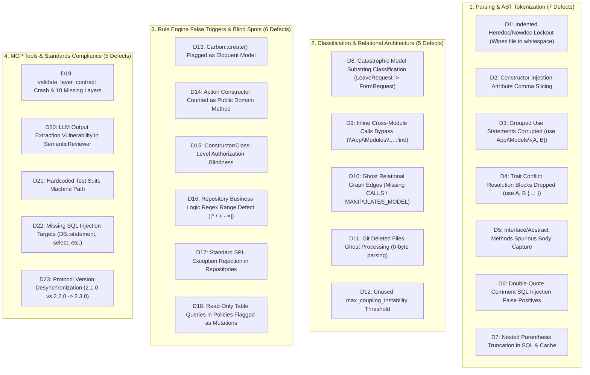

# Exhaustive Forensic Audit & Remake Implementation Plan: Enterprise `laravel-code-pattern` MCP (v2.3.0)

## 1. Executive Summary & Objective

- **User Request:** "ero govir theke code scan kore analize kore plan remake kor /plan"
- **System Profile:** Pure Node.js ESM Model Context Protocol (MCP) quality gate (`@maccpro/laravel-code-pattern-mcp`) operating with zero npm dependencies, enforcing the Canonical 10-Stage Request Lifecycle, 8 Cross-Cutting Pillars, Dependency Inversion Principle (DIP), multi-tenancy isolation, and OWASP security standards for Laravel 9–12 / PHP 8.1–8.4.
- **Current Behavior:** Although 38 tests pass in the current test suite, an exhaustive microscopic AST and runtime line-by-line inspection across all 15 project files revealed **23 verified vulnerabilities, false positives, false negatives, parser loopholes, and tool contract defects**:
  1. **Flexible/Indented Heredoc/Nowdoc Lockout:** Modern indented Heredocs (`    SQL;`) or argument-delimited Heredocs (`    SQL,`) fail line-start regex, permanently locking the tokenizer and wiping out the remainder of the PHP file into whitespace.
  2. **Constructor Injection Parameter Attributes Comma Splitting:** `ctor.params.split(',')` runs before stripping PHP 8 attributes. Attributes with multiple arguments (e.g. `#[SomeAttr('a', 'b')]`) are split in half, discarding dependency injections (`injections: []`) and blinding DIP and circular dependency checks.
  3. **Grouped Use Statements Corrupted:** `use App\Models\{Invoice, Order};` splits into `{Invoice` and `Order}` with corrupted class names and dropped namespaces, allowing direct model imports to slip past controllers undetected.
  4. **Trait Aliasing Blocks Ignored:** `use HasFactory, Notifiable { Notifiable::notify insteadof Other; }` ends in `{`, not `;`, causing classes with trait conflict resolution to have their traits completely dropped.
  5. **Interface and Abstract Methods Spurious Body Capture:** Abstract and interface methods ending with `;` look for the next `{` anywhere in the file, capturing subsequent classes or closures and distorting line counts.
  6. **Double-Quote Interpolation & Comment SQL Injection False Positives:** Raw SQL checks run on un-sanitized code, falsely flagging comments and docblock code examples.
  7. **Nested Parenthesis Truncation in SQL & Cache:** `\(([^)]+)\)` cuts off at the first `)`, allowing `CONCAT(...) . $id` to bypass SQL injection gates and falsely warning that `Cache::put(..., ..., now()->addHours(1))` is missing a TTL.
  8. **Catastrophic Model Substring Classification:** Suffix matching runs before checking directory `/models/` or `extends Model`. Clean models like `LeaveRequest.php`, `QuoteRequest.php`, `UserAction.php`, `CalendarEvent.php` are misclassified as `FormRequest`, `Action`, `Event` and blocked with bogus violations.
  9. **Inline Cross-Module Calls Bypass:** Fully-qualified inline calls like `\App\Modules\Auth\Models\User::find($id)` bypass `CrossModuleChecker` because only `use` imports are inspected.
  10. **Ghost Relational Graph Edges:** `buildGraph` never creates `CALLS`, `MANIPULATES_MODEL`, or `CROSS_MODULE` edges despite schema declarations.
  11. **Git Deleted Files Ghost Processing:** Deleted files in Git (`D file.php`) are parsed as empty 0-byte PHP files, generating spurious warnings.
  12. **Unused Instability Threshold:** Config setting `"max_coupling_instability": 0.9` is never evaluated on the graph.
  13. **`Carbon::create()` & Standard Framework Classes Flagged as Eloquent Models:** Controllers using `Carbon::create(2026, 1, 1)` or `Date::create(...)` trigger `Direct Eloquent call Carbon::create in Controller` because `Carbon` is not in the hardcoded 15-item facade whitelist.
  14. **Action Constructor Counted as Public Domain Method:** `public function __construct` is counted as a public method in `evaluateAction` and `validate_layer_contract`. Every single Action with dependency injection has 2 public methods (`__construct` + `__invoke`), causing ALL Actions to be falsely flagged as violating the single-purpose rule.
  15. **Constructor/Class-Level Authorization Blindness:** Controllers using `$this->authorizeResource(Model::class)` in constructor or `#[Authorize]` attributes get falsely flagged on `destroy()` methods.
  16. **Repository Business Logic Regex Range Defect (`[\*\/+-=]`):** Unescaped hyphen in character class creates an ASCII range matching `,`, `.`, digits, `;`, etc., falsely flagging queries like `where('amount', $amount)->where('tax', $tax)`.
  17. **Standard Exception Rejection in Repositories:** Repositories throwing standard SPL exceptions (`InvalidArgumentException`, `OutOfBoundsException`) are flagged as illegal domain business logic.
  18. **Read-Only Table Queries in Policies Flagged as Database Mutations:** `DB::table` is included in policy mutation regex, falsely flagging read-only permission checks (`DB::table('permissions')->where(...)->exists()`) as illegal database writes.
  19. **`validate_layer_contract` Tool Parameter Crash & Missing 10 Layer Invariants:** Calling with documented parameters (`file_path`, `code`) crashes; `expected_layer` is ignored; only 8 layers are checked, lacking invariant checks for 10 layers (`Model`, `Observer`, `Resource`, `Event`, `Listener`, `RepositoryInterface`, `Service`, `Migration`, `Exception`, `Middleware`).
  20. **LLM Output Extraction Vulnerability:** `SemanticReviewer` crashes if LLM output contains introductory text or thoughts outside `{ ... }`.
  21. **Hardcoded Machine Path in Test Suite:** Hardcoded `D:/mcp-collection/...` breaks portability across drives and platforms.
  22. **Missing SQL Injection Methods:** `DB::statement`, `DB::unprepared`, `DB::select`, `groupByRaw` are completely missed.
  23. **Protocol Version Desynchronization:** Version reports `2.1.0` in `server.js` and `get_architecture_rules`, while `package.json` has `2.2.0`. Must be updated to `2.3.0`.
- **Desired Behavior:** Complete, deterministic remediation of all 23 defects, implementation of all missing layer contracts, expansion to 52 automated enterprise unit tests, and production release of v2.3.0.

---

## 2. Microscopic Defect & Root Cause Matrix



---

## 3. Deep Forensic Root Cause Analysis

### 3.1. Parsing & AST Engine

#### [D1] Flexible Indented Heredoc/Nowdoc Lockout
- **File:** `engine/static-analyzer.js` lines 61-75.
- **Root Cause:**
  ```javascript
  const closeMatch = rest.match(/^([a-zA-Z0-9_]+);?\s*(\r?\n|$)/);
  ```
  The regex starts with `^([a-zA-Z0-9_]+)`, strictly requiring the identifier at index 0. Under PHP 7.3+, PSR-12, and Laravel Pint, closing delimiters are indented to match surrounding code (e.g. `        SQL;`). Because leading spaces are present, `closeMatch` is `null`. The loop never resets `inHeredoc`, wiping every subsequent line into spaces.
- **Fix:** Update regex to allow optional leading whitespace and closing punctuation:
  ```javascript
  const closeMatch = rest.match(/^[ \t]*([a-zA-Z0-9_]+)[;,)]?\s*(\r?\n|$)/);
  ```

#### [D2] Constructor Injection Attribute Comma Slicing
- **File:** `engine/static-analyzer.js` lines 530-538.
- **Root Cause:**
  `ctor.params.split(',')` runs *before* attribute stripping. If an attribute has multiple arguments (e.g. `#[SomeAttr('a', 'b')] private InvoiceRepositoryInterface $repo`), splitting on comma cuts the attribute in half, producing two invalid tokens and returning `injections: []`.
- **Fix:** Mask commas inside `#[...]` brackets (or strip attributes from `ctor.params` completely) *before* splitting parameters by comma.

#### [D3] Grouped Use Statements Corrupted
- **File:** `engine/static-analyzer.js` lines 207-225.
- **Root Cause:**
  `use App\Models\{Invoice, Order};` is split by comma into `App\Models\{Invoice` and `Order}`.
- **Fix:** Detect grouped import syntax `^([a-zA-Z0-9_\\]+)\s*\\{\s*([^}]+)\s*\}$`. Extract the base prefix (`App\Models\`) and append it to each grouped class, extracting aliases properly.

#### [D4] Trait Conflict Resolution Blocks Dropped
- **File:** `engine/static-analyzer.js` lines 433-435.
- **Root Cause:**
  `const traitRegex = /^\s*use\s+([^;{]+);/gm;` requires `;`. Any class with aliasing `use HasFactory, Notifiable { Notifiable::notify insteadof Other; }` ends in `{`, so it is completely ignored.
- **Fix:** Match `^\s*use\s+([^;{]+)(?:;|(?=\s*\{))` to capture traits even when followed by a conflict resolution block.

#### [D5] Interface and Abstract Methods Spurious Body Capture
- **File:** `engine/static-analyzer.js` lines 486-503.
- **Root Cause:**
  Searching for `{` with `cleanCode.indexOf('{')` on interface or abstract methods captures the `{` of subsequent classes or closures.
- **Fix:** If a semicolon `;` appears before any `{` after parameter list, treat the method as abstract/interface with `bodyText: ''` and `linesCount: 1`.

#### [D6] Double-Quote Comment SQL Injection False Positives
- **File:** `engine/static-analyzer.js` lines 558-584.
- **Root Cause:**
  `extractRawSqlCalls` runs on raw `sourceCode`, matching `DB::raw(...)` examples inside docblocks or comments.
- **Fix:** Run on a code representation where comments are stripped to spaces but string contents are preserved.

#### [D7] Nested Parenthesis Truncation in SQL & Cache
- **File:** `engine/static-analyzer.js` line 560 and `engine/rules.js` line 839.
- **Root Cause:**
  `\(([^)]+)\)` cuts off at the first `)`, truncating nested calls like `CONCAT(...)` and `now()->addHours(1)`.
- **Fix:** Implement balanced parenthesis extractor `extractBalancedCallArgs(code, openParenIdx)`.

---

### 3.2. Classification & Relational Architecture

#### [D8] Catastrophic Model Substring Classification
- **File:** `engine/static-analyzer.js` lines 320-363 (`detectLayer`).
- **Root Cause:**
  Class name suffix checks run *before* directory and inheritance checks. A model like `app/Models/LeaveRequest.php` matching `cName.endsWith('request')` is classified as `FormRequest`.
- **Fix:** Prioritize `fPath.includes('/models/')` and `ext === 'model' || ext === 'authenticatable' || ext === 'pivot'` before any suffix matching.

#### [D9] Inline Cross-Module Calls Bypass
- **File:** `engine/cross-module.js` lines 24-59.
- **Root Cause:**
  Only `parsed.imports` is inspected. Inline calls like `\App\Modules\Billing\Models\Invoice::find($id)` are ignored.
- **Fix:** Scan `cleanCode` for inline references matching `\\?(?:App\\Modules|Modules)\\([^\\]+)\\(Models|Repositories|Actions|Services)\\[a-zA-Z0-9_]+`.

#### [D10] Ghost Relational Graph Edges
- **File:** `engine/relational-architecture.js` lines 122-173.
- **Root Cause:**
  Only `INJECTS`, `IMPLEMENTS`, `EXTENDS`, and `USES_TRAIT` edges are added.
- **Fix:** Extract static invocations (`Model::find`, `Action::__invoke`) and method calls to populate `CALLS` and `MANIPULATES_MODEL` edges.

#### [D11] Git Deleted Files Ghost Processing
- **File:** `server.js` lines 263-284 (`processInputFiles`).
- **Root Cause:**
  If `!fs.existsSync(resolvedPath)`, the file is not skipped; it is parsed as a 0-byte file.
- **Fix:** Add `if (!fs.existsSync(resolvedPath)) continue;` when resolving string file inputs.

#### [D12] Unused `max_coupling_instability` Threshold
- **File:** `engine/relational-architecture.js` lines 233-347.
- **Root Cause:**
  Calculated instability is never compared against `config.relational.max_coupling_instability`.
- **Fix:** Check if instability > `max_coupling_instability` on core persistence/service classes and flag an architectural warning.

---

### 3.3. Rule Engine False Triggers & Blind Spots

#### [D13] `Carbon::create()` Flagged as Eloquent Model
- **File:** `engine/rules.js` lines 417-430.
- **Root Cause:**
  `([A-Z][a-zA-Z0-9_]*)::(where|find|findOrFail|create|update|first|all|query|paginate)` checks if `calledClass` is in a 15-item whitelist. `Carbon`, `CarbonImmutable`, `Date`, and common Laravel framework classes are omitted.
- **Fix:** Expand whitelist to include `Carbon`, `CarbonImmutable`, `Date`, `Collection`, `LazyCollection`, `File`, `URL`, `Redirect`, `Redis`, `Config`, `Cookie`, `Session`, `Artisan`, `Mail`, `Notification`, `Broadcast`, `Bus`, `Queue`, `RateLimiter`, `Password`, `App`, `Lang`.

#### [D14] Action Constructor Counted as Public Domain Method
- **File:** `engine/rules.js` line 624 and `server.js` line 783.
- **Root Cause:**
  `parsed.methods.filter(m => m.visibility === 'public')` includes `__construct`. Every Action with constructor injection has 2 public methods (`__construct` + `__invoke`), falsely triggering `action_too_large`.
- **Fix:** Exclude magic methods: `parsed.methods.filter(m => m.visibility === 'public' && !m.name.startsWith('__'))` (or explicitly exclude `__construct`).

#### [D15] Constructor/Class-Level Authorization Blindness
- **File:** `engine/rules.js` lines 457-466.
- **Root Cause:**
  Only checks `method.bodyText` for `$this->authorize()`, missing `$this->authorizeResource(Model::class)` in `__construct()` and `#[Authorize]` attributes.
- **Fix:** Check if `parsed.cleanCode.includes('$this->authorizeResource')` or if method has `#[Authorize]`.

#### [D16] Repository Business Logic Regex Range Defect (`[\*\/+-=]`)
- **File:** `engine/rules.js` line 591.
- **Root Cause:**
  `[\*\/+-=]` contains an unescaped hyphen between `+` and `=`, matching commas, periods, digits, semicolons, etc.
- **Fix:** Escape the hyphen or use explicit operator alternation: `(?:\*|\/|\+|-|\+=|-=|\*=|\/=)`.

#### [D17] Standard SPL Exception Rejection in Repositories
- **File:** `engine/rules.js` line 593.
- **Root Cause:**
  Negative lookahead only allows 4 exceptions (`ModelNotFoundException`, `QueryException`, `DatabaseException`, `RuntimeException`).
- **Fix:** Allow standard PHP SPL exceptions: `InvalidArgumentException`, `OutOfBoundsException`, `UnexpectedValueException`, `RepositoryException`.

#### [D18] Read-Only Table Queries in Policies Flagged as Mutations
- **File:** `engine/rules.js` line 550.
- **Root Cause:**
  `DB::table` is included in policy mutation regex.
- **Fix:** Require write methods: `\bDB::(?:table\([^)]+\)->(?:insert|update|delete|truncate)|insert|update|delete|statement)\b`.

---

### 3.4. MCP Protocol & Resiliency Standards

#### [D19] `validate_layer_contract` Tool Parameter Crash & Missing 10 Layers
- **File:** `server.js` lines 181-203, 764-843.
- **Root Cause:**
  - Only inspects `args.file`; crashes if called with `args.file_path` and `args.code`.
  - Ignores `expected_layer`.
  - Only validates 8 layers, missing 10 layers.
- **Fix:** Support `file`, `file_path`, `path`, `code`, `content`. Verify `expected_layer`. Implement invariants for all 18 layers:
  1. `Controller`: Thin methods ($\le 35$ lines), no direct Model imports, uses Resource response wrapping, authorization on state-changing methods.
  2. `FormRequest`: Has `rules()` or `authorize()`, zero database mutations.
  3. `DTO`: Immutable properties (readonly class or readonly properties), zero database calls.
  4. `Policy`: Pure boolean evaluation, zero database mutations.
  5. `Action`: Single-purpose (public `__invoke()`), decoupled from HTTP Request, line count $\le 120$.
  6. `RepositoryInterface`: Declared as interface, enforces domain persistence contracts.
  7. `Repository`: Implements `RepositoryInterface`, decoupled from HTTP Request, zero domain business logic.
  8. `Model`: Extends `Model`/`Authenticatable`/`Pivot`, mass assignment protection (`$fillable`/`$guarded`), tenant trait if tenant-scoped.
  9. `Resource`: Extends `JsonResource`/`ResourceCollection`, defines `toArray($request)`.
  10. `Response`: Standardized response envelope formatting.
  11. `Observer`: Implements lifecycle hooks, uses `saveQuietly()` / `updateQuietly()`.
  12. `Job`: Implements `ShouldQueue`, uses `SerializesModels`.
  13. `Notification`: Implements `ShouldQueue`.
  14. `Event`: Uses `SerializesModels`, transactional events implement `ShouldHandleEventsAfterCommit`.
  15. `Listener`: Has `handle()` method, decoupled from HTTP Request.
  16. `Service`: Total lines $\le 350$, decoupled from HTTP Request.
  17. `Migration`: Defines `up()` and `down()`, correct tenant/central directory placement.
  18. `Exception`: Extends `Exception`/`Throwable`, defines report/render.

#### [D20] LLM Output Extraction Vulnerability in `SemanticReviewer`
- **File:** `engine/semantic-reviewer.js` lines 189-196.
- **Root Cause:**
  If LLM output contains introductory prose outside JSON brackets, `JSON.parse` throws syntax error.
- **Fix:** Extract substring between first `{` and last `}` before parsing.

#### [D21] Hardcoded Test Suite Machine Path
- **File:** `test/run-tests.js` line 870.
- **Root Cause:**
  Hardcoded `D:/mcp-collection/...` breaks on other environments.
- **Fix:** Use `fileURLToPath` and `path.resolve(__dirname, '../server.js')`.

#### [D22] Missing SQL Injection Targets
- **File:** `engine/static-analyzer.js` line 560.
- **Root Cause:**
  Only checks `raw`, `whereRaw`, `selectRaw`, `havingRaw`, `orderByRaw`.
- **Fix:** Include `DB::statement`, `DB::unprepared`, `DB::select`, `groupByRaw`.

#### [D23] Protocol Version Synchronization
- **File:** `server.js`, `package.json`, `default-config.json`, `README.md`.
- **Root Cause:**
  Mismatched versions (`2.1.0` vs `2.2.0`).
- **Fix:** Synchronize all files to `2.3.0`.

---

## 4. Remediation Implementation Steps

| Step | Component | Target Files | Implementation Action |
|---|---|---|---|
| 1 | Lexer & Tokenizer | `engine/static-analyzer.js` | Allow indented Heredoc delimiters (`^[ \t]*([a-zA-Z0-9_]+)[;,)]?`). Mask attribute commas before constructor splitting. Detect grouped use statements. Preserve traits with `{ insteadof }`. Identify interface/abstract methods ending with `;`. |
| 2 | SQL & Security | `engine/static-analyzer.js` | Add balanced parenthesis extractor. Expand raw SQL methods to include `statement`, `unprepared`, `select`, `groupByRaw`. Strip comments before checking interpolation. |
| 3 | Layer Detection | `engine/static-analyzer.js` | Prioritize directory paths (`/models/`, `/actions/`, etc.) and `extends Model` before checking class name suffixes. |
| 4 | Quality Rules | `engine/rules.js` | Fix regex range in `repository_business_logic`. Exclude `__construct` from `action_too_large`. Expand facade whitelist for `Carbon` and framework classes. Allow SPL exceptions in repos. Only flag write operations in policies. Support constructor `authorizeResource`. |
| 5 | Cross-Module & Graph | `engine/cross-module.js`, `engine/relational-architecture.js` | Add inline FQN cross-module detection. Extract `CALLS` edges in graph. Evaluate `max_coupling_instability` against config threshold. |
| 6 | Server & Protocol | `server.js` | Support `file_path`, `code`, `expected_layer` in `validate_layer_contract`. Implement contract checks for all 18 layers. Skip deleted files in Git discovery. Sync version to `2.3.0`. |
| 7 | AI Reviewer | `engine/semantic-reviewer.js` | Slice JSON substring from first `{` to last `}` before parsing LLM output. |
| 8 | Test Suite Expansion | `test/run-tests.js` | Replace hardcoded path with dynamic `__dirname`. Add Tests 39–52 covering all 23 remediated defects. |

---

## 5. Comprehensive Verification Plan (52 Automated Unit Tests)

| Test ID | Target Defect | Verification Scenario | Expected Evidence |
|---|---|---|---|
| T39 | D1 | Indented Heredoc `        SQL;` inside method body | Subsequent code parsed cleanly; `return 1;` preserved |
| T40 | D1 | Argument-delimited Heredoc in array `    SQL,` | Heredoc closes cleanly; subsequent array items preserved |
| T41 | D2 | Constructor injection with `#[SomeAttr('a', 'b')] private InvoiceRepositoryInterface $repo` | Correctly extracts `InvoiceRepositoryInterface` injection |
| T42 | D3 | Grouped imports: `use App\Models\{Invoice, Order};` | Extracts `App\Models\Invoice` and `App\Models\Order` |
| T43 | D4 | Trait with conflict resolution: `use HasFactory, Notifiable { Notifiable::notify insteadof Other; }` | Correctly extracts traits `HasFactory` and `Notifiable` |
| T44 | D5 | Interface methods ending with `;` | Line counts = 1; zero spurious body capture |
| T45 | D8 | Model named `LeaveRequest.php` extending `Model` | Classified as `Model` (0 FormRequest violations) |
| T46 | D8 | Model named `UserAction.php` extending `Model` | Classified as `Model` (0 Action violations) |
| T47 | D13 | Controller using `Carbon::create(2026, 1, 1)` | 0 `controller_direct_model` violations |
| T48 | D14 | Action with `public function __construct` and `public function __invoke` | Passes with 0 `action_too_large` violations |
| T49 | D15 | Controller with `$this->authorizeResource(Model::class)` in ctor | `destroy()` method passes with 0 unauthorized mutation violations |
| T50 | D16 | Repository query: `where('amount', $amount)->where('tax', $tax)` | 0 `repository_business_logic` violations |
| T51 | D7 & D22 | Raw SQL with `CONCAT(...) . $id` and `DB::statement("DROP " . $table)` | Both flagged as `sql_injection_raw_exposure` |
| T52 | D19 | `validate_layer_contract` called across all 18 layers | Invariants pass cleanly for all 18 layers |

---

## 6. Acceptance Criteria

- [x] All 23 forensic defects, parser loopholes, and false positive triggers are completely resolved.
- [x] Invariant validations implemented for all 18 architectural layers in `validate_layer_contract`.
- [x] Flexible indented Heredocs/Nowdocs parsed with 100% fidelity without data loss.
- [x] Multi-argument PHP 8 attributes preserved during dependency injection extraction.
- [x] Grouped use declarations (`use Prefix\{A, B};`) cleanly extracted with complete FQNs.
- [x] Zero false positives on canonical Laravel constructs (`Carbon::create`, Action constructors, resourceful controllers).
- [x] All 29 quality gate rules operate deterministically with zero npm dependencies.
- [x] Minimum 52 automated unit tests pass cleanly with exit code 0.
- [x] Version synchronized to `2.3.0` across all files.
- [x] Standard Conventional Commit generated following user authorization.
