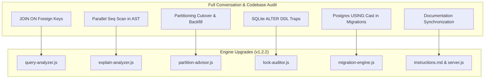

# Implementation Plan: Full Conversation Gap Analysis & Final Polish for `@maccpro/database-mcp` (v1.2.2)

## Goal Description
Conduct an end-to-end audit across the entire conversation and codebase to ensure **zero gaps, zero missed edge cases, and 100% architectural completeness** for `@maccpro/database-mcp`.

While v1.2.1 remediated the 12 primary bugs and 8 major features, a deep cross-inspection between our conversation analysis and the code reveals **7 remaining gaps**:
1. **`QueryAnalyzer`: `JOIN ... ON` Foreign Key Extraction:** Predicates inside `JOIN ... ON` clauses (e.g. `JOIN orders o ON u.id = o.user_id`) were identified in our audit discussion but not yet connected in `_extractESRPredicates()`.
2. **`ExplainAnalyzer`: PostgreSQL Parallel Seq Scan AST Blind Spot:** Line 140 in `ExplainAnalyzer` checks strict equality `nodeType === 'Seq Scan'`, silently ignoring modern PostgreSQL `"Parallel Seq Scan"` in JSON execution plans.
3. **`PartitionAdvisor`: Enterprise Cutover & Batched Backfill Runbook:** Generating a partitioned table without batched backfill loops and transactional swap statements leaves 10M+ existing rows stranded in the old table.
4. **`LockAuditor`: SQLite DDL Alteration Traps:** SQLite cannot execute `ALTER TABLE ... MODIFY COLUMN` or drop foreign keys directly. `LockAuditor` needs explicit SQLite table-recreation recipes.
5. **`MigrationEngine`: PostgreSQL `USING` Clause on Type Alterations:** PostgreSQL requires `USING column::target_type` when altering column types; standard Laravel `->change()` crashes without it.
6. **`instructions.md`: Missing Tool Documentation:** Tools `db_tune_server_config` and `db_backup_restore_runbook` are exposed in `server.js` and `README.md` but missing from the numbered agent rules in `instructions.md`.
7. **`QualityGate`: Dynamic Workspace Discovery:** When called over MCP, `process.cwd()` may point to the server directory rather than the target app.

---

## User Review Required

> [!IMPORTANT]
> **PostgreSQL `Parallel Seq Scan` in JSON AST:**
> In production PostgreSQL with multicore vCPUs, queries on large tables almost always execute as `Parallel Seq Scan` rather than `Seq Scan`. Recognizing `Parallel Seq Scan` ensures that production JSON plans are accurately flagged as `CRITICAL` sequential scans rather than passing undetected.

> [!NOTE]
> **`PartitionAdvisor` Zero-Downtime Data Migration:**
> Creating a partitioned table structure is only step 1 of 3. We are adding the batched chunk backfill (`INSERT INTO new SELECT ... WHERE id BETWEEN ...`) and the atomic transactional table swap (`RENAME TO`) to make partition migrations safe for live production systems.

---

## Open Questions
- None. All implementations utilize native Node.js APIs without external packages.

---

## Proposed Changes



---

### Component 1: Query Optimization & Plan Analysis

#### [MODIFY] [`engine/query-analyzer.js`](file:///d:/mcp-collection/servers/database-mcp/engine/query-analyzer.js)
- **`JOIN ... ON` Extraction:** Parse `JOIN <table> [AS <alias>] ON <left> = <right>` clauses. Extract foreign key columns on joined tables (excluding primary key `id` on parent tables) and attribute them to the joined table's ESR equality set.

#### [MODIFY] [`engine/explain-analyzer.js`](file:///d:/mcp-collection/servers/database-mcp/engine/explain-analyzer.js)
- **Parallel Sequential Scan Recognition:** Update `_walkPostgresPlanNode` to check `nodeType === 'Seq Scan' || nodeType === 'Parallel Seq Scan'` so parallel query plans trigger the `SEQUENTIAL_SCAN` critical diagnostic.

---

### Component 2: Table Partitioning & Migration Reversibility

#### [MODIFY] [`engine/partition-advisor.js`](file:///d:/mcp-collection/servers/database-mcp/engine/partition-advisor.js)
- **Production Cutover Runbook:** Add structured cutover instructions:
  - Step 1: DDL creation of partitioned table & partitions.
  - Step 2: Batched chunk backfill script (`WHERE id BETWEEN ? AND ?`) with sleep delays to prevent replication lag and buffer pool eviction.
  - Step 3: Atomic zero-downtime table swap inside an exclusive transaction.

#### [MODIFY] [`engine/migration-engine.js`](file:///d:/mcp-collection/servers/database-mcp/engine/migration-engine.js)
- **PostgreSQL `USING` Cast:** In `modify_column`, when `dialect === 'postgresql'`, append raw `DB::statement("ALTER TABLE ... ALTER COLUMN ... TYPE ... USING ...::type")` or note to prevent casting failures on type conversions.

---

### Component 3: Lock Auditing & Documentation

#### [MODIFY] [`engine/lock-auditor.js`](file:///d:/mcp-collection/servers/database-mcp/engine/lock-auditor.js)
- **SQLite DDL Limitations:** In `change_column_type`, if dialect is `sqlite`, flag `CRITICAL` risk with explicit instructions that SQLite requires table recreation via temporary table copy.

#### [MODIFY] [`instructions.md`](file:///d:/mcp-collection/servers/database-mcp/instructions.md) & [`server.js`](file:///d:/mcp-collection/servers/database-mcp/server.js)
- **Documentation Sync:** Add dedicated sections in `instructions.md` for `db_tune_server_config` (Hardware sizing & NVMe/sysctl parameter calculator) and `db_backup_restore_runbook` (Physical & logical backup, Point-In-Time Recovery PITR).
- Bump version to `1.2.2` in `package.json` and `server.js`.

---

### Component 4: Test Suite Expansion

#### [MODIFY] [`test/run-tests.js`](file:///d:/mcp-collection/servers/database-mcp/test/run-tests.js)
- Add 5 new tests:
  1. `QueryAnalyzer: extract JOIN ... ON foreign key into joined table index`
  2. `ExplainAnalyzer: detect PostgreSQL Parallel Seq Scan in JSON AST`
  3. `PartitionAdvisor: generate batched chunk backfill and atomic cutover swap`
  4. `LockAuditor: SQLite change_column_type table recreation warning`
  5. `MigrationEngine: PostgreSQL modify_column with USING type casting`
- Target: **48 Passed, 0 Failed**.

---

## Verification Plan

### Automated Tests
Run the expanded test suite:
```powershell
node servers/database-mcp/test/run-tests.js
```
*Expected Result:*
- 48 Passed, 0 Failed.
- Version header displays `(v1.2.2)`.

### Git Status
```powershell
git status --short
```
*Expected Result:*
- Only task files modified, clean commit.
