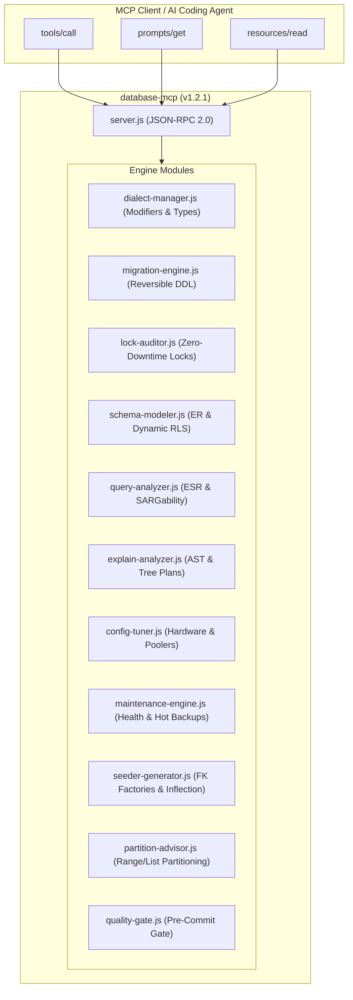

# Implementation Plan: Enterprise Remediation & Production Hardening for `@maccpro/database-mcp` (v1.2.1)

## Goal Description
Perform a comprehensive forensic remediation and feature expansion on `@maccpro/database-mcp` (v1.2.1). The audit identified 12 critical bugs (e.g. inverted lock hazard logic, dropped column modifiers on UUID/ULID, hardcoded `::bigint` in PostgreSQL RLS, foreign key constraint violations in seeders, MySQL Error 1503 in table partitioning, and invalid SQLite fallback) and 8 missing capabilities (e.g. modern MySQL 8.0+ `EXPLAIN ANALYZE` tree parsing, PostgreSQL partial indexes, SQLite zero-downtime hot backups). 

This plan details the exact architectural changes across all 11 engine modules, server protocol handlers, and test suites to achieve a 100% deterministic, zero-defect, offline database MCP server.

---

## User Review Required

> [!IMPORTANT]
> **PostgreSQL Concurrency Default Fix in `LockAuditor`:**
> Previously, omitting `concurrent` defaulted to `LOW RISK` due to `op.concurrent !== false`. The fix strictly requires `op.concurrent === true` to be rated `LOW RISK`. Any migration creating or dropping an index without explicit `concurrent: true` is now flagged as `HIGH RISK` because standard PostgreSQL DDL acquires a `ShareLock` or `AccessExclusiveLock`.

> [!WARNING]
> **PgBouncer Transaction Pooling Mode PDO Configuration:**
> In `engine/config-tuner.js`, the note previously advised disabling PDO emulation. In PgBouncer transaction pooling mode, named server-side prepared statements collide across multiplexed backend connections. The recommendation is corrected to set `PDO::ATTR_EMULATE_PREPARES => true` (or configure `max_prepared_statements` in PgBouncer 1.21+).

> [!NOTE]
> **MySQL Table Partitioning Pre-Requisite (Error 1503):**
> MySQL requires that all columns used in `PARTITION BY RANGE` must be included in the table's `PRIMARY KEY`. The advisor now generates explicit pre-requisite DDL to modify the primary key to composite `(id, created_at)` before applying table partitioning.

---

## Open Questions
- None. All requirements and architectural specifications are self-contained within `@maccpro/database-mcp` and adhere to 100% native Node.js zero-dependency standards.

---

## Proposed Changes



---

### Core Engine & Dialect Mapping

#### [MODIFY] [`engine/dialect-manager.js`](file:///d:/mcp-collection/servers/database-mcp/engine/dialect-manager.js)
- **Eliminate Early Returns:** Replace hardcoded returns on `id`, `uuid`, `ulid`, `foreign_uuid`, `foreign_ulid`, `morphs`, `uuidMorphs`, `ulidMorphs`, `rememberToken`, and `softDeletes` with progressive method builders.
- **Modifier Retention:** Ensure all modifiers (`->nullable()`, `->unique()`, `->index()`, `->default()`, `->comment()`, `->after()`, `->check()`, `->storedAs()`) chain properly without being dropped.
- **PostgreSQL Generated Column Safety:** Automatically map `virtualAs()` to `storedAs()` for PostgreSQL since Postgres only supports stored generated columns.

#### [MODIFY] [`engine/migration-engine.js`](file:///d:/mcp-collection/servers/database-mcp/engine/migration-engine.js)
- **Tenant Scope Alignment:** When `isTenant` or `scope: 'tenant'` is specified, automatically inject `tenant_id` and convert single-column unique indexes to tenant-scoped composite unique indexes `['tenant_id', ...column]`.
- **PostgreSQL Concurrent Drop Index:** Support `concurrent: true` in `drop_indexes` by emitting `DROP INDEX CONCURRENTLY IF EXISTS` and setting `public bool $withinTransaction = false;`.
- **PostgreSQL Partial Indexes:** Support `idx.where` condition in `add_indexes` (e.g. `WHERE status = 'active'`).

---

### Concurrency, Lock Auditing & Security Policies

#### [MODIFY] [`engine/lock-auditor.js`](file:///d:/mcp-collection/servers/database-mcp/engine/lock-auditor.js)
- **Inverted Logic Remediation:** Change `op.concurrent !== false` to `op.concurrent === true` for both `add_index` and `drop_index`.
- **Expanded Lock Hazards:** Add dedicated hazard assessments for:
  - `truncate_table`: Critical AccessExclusiveLock and table lock risks.
  - `drop_table`: Critical data destruction and metadata lock blocking.
  - `add_primary_key` / `modify_primary_key`: Full table rebuild in MySQL/InnoDB (clustered index copy).
  - `unindexed_foreign_key`: High-risk cascade table scan locks during parent row deletion.
  - `convert_charset` / `change_collation`: Critical full table rewrite under exclusive table lock.

#### [MODIFY] [`engine/schema-modeler.js`](file:///d:/mcp-collection/servers/database-mcp/engine/schema-modeler.js)
- **Dynamic RLS Type Casting:** Pass `primary_key_type` to `_generateTenantPolicies()`. Cast `current_setting('app.current_tenant_id', true)` to `::uuid` when PK is UUID, `::text` when ULID, and `::bigint` when integer ID.
- **Explicit `WITH CHECK`:** Append `WITH CHECK` to prevent cross-tenant insertion leaks.

---

### SARGability, Query Optimization & Execution Plans

#### [MODIFY] [`engine/query-analyzer.js`](file:///d:/mcp-collection/servers/database-mcp/engine/query-analyzer.js)
- **Numeric Literal Exclusion:** Ignore pure numbers `/^[0-9]+$/` in equality, range, and sort regex matching to prevent queries with `WHERE 1 = 1` from creating index columns named `1`.
- **Robust English Singularization:** Replace naive `.replace(/s$/, '')` with inflection helper handling `ies` $\rightarrow$ `y` (`categories` $\rightarrow$ `Category`), `sses` $\rightarrow$ `ss` (`addresses` $\rightarrow$ `Address`), `status`, `business`, etc.

#### [MODIFY] [`engine/explain-analyzer.js`](file:///d:/mcp-collection/servers/database-mcp/engine/explain-analyzer.js)
- **MySQL 8.0+ Tree-Format Recognition:** Add regex detection for `-> Table scan on <table_name>`, `-> Sort:`, `-> Temporary table`, and `-> Index lookup` in `_analyzeMySQLPlanText()`.
- **Clean Fallback Execution:** Guard JSON vs Text parsing so plain text regexes are not run on JSON string representations.

---

### High-Availability, Maintenance & Seeders

#### [MODIFY] [`engine/config-tuner.js`](file:///d:/mcp-collection/servers/database-mcp/engine/config-tuner.js)
- **Correct PgBouncer Emulation Advice:** Advise `PDO::ATTR_EMULATE_PREPARES => true` in Laravel's `config/database.php` for PgBouncer transaction pooling mode.

#### [MODIFY] [`engine/maintenance-engine.js`](file:///d:/mcp-collection/servers/database-mcp/engine/maintenance-engine.js)
- **Dedicated SQLite Runbook (`_getSQLiteRunbook`):** Generate `PRAGMA integrity_check;`, `PRAGMA foreign_key_check;`, `PRAGMA freelist_count;`, `VACUUM;`, `PRAGMA optimize;`, and `PRAGMA wal_checkpoint(TRUNCATE);`.
- **SQLite Zero-Downtime Hot Backup:** In `getBackupRunbook`, emit `VACUUM INTO 'backup.sqlite'` (supported in SQLite 3.27+) and `.backup` CLI syntax.

#### [MODIFY] [`engine/seeder-generator.js`](file:///d:/mcp-collection/servers/database-mcp/engine/seeder-generator.js)
- **Foreign Key Factory Binding:** Detect `*_id` foreign key columns (e.g. `user_id`, `category_id`) and automatically bind them to `\App\Models\Parent::factory()` instead of random integers, preventing constraint crashes.
- **Robust Model Inflection:** Utilize singularization helper for model names.
- **Empty Tenant Guard:** Ensure at least one tenant exists before looping `Tenant::all()` in multi-tenant seeders.

#### [MODIFY] [`engine/partition-advisor.js`](file:///d:/mcp-collection/servers/database-mcp/engine/partition-advisor.js)
- **MySQL Primary Key Harmonization:** Emit pre-requisite guidance for composite primary key `(id, created_at)` to eliminate MySQL Error 1503.
- **SQLite Unsupported Advisory:** Return structured guidance explaining that SQLite does not support native partitioning and provide archival table recipes.

#### [MODIFY] [`engine/quality-gate.js`](file:///d:/mcp-collection/servers/database-mcp/engine/quality-gate.js)
- **Fluent Unique Constraint Detection:** Detect `$table->string('email')->unique();` and `$table->uuid('code')->unique();` in tenant migrations.
- **Dialect-Aware Concurrency Check:** Suppress non-concurrent warnings when dialect is explicitly MySQL or SQLite.

---

### Protocol Server & Verification

#### [MODIFY] [`server.js`](file:///d:/mcp-collection/servers/database-mcp/server.js) & [`package.json`](file:///d:/mcp-collection/servers/database-mcp/package.json)
- Add `sqlite` to `db_maintenance_runbook`, `db_backup_restore_runbook`, `db_data_masking_runbook`, and `db_partitioning_advisor` dialect schemas.
- In JSON-RPC line handler, return `-32700 Parse error` on invalid JSON.
- In `prompts/get`, return `-32602 Prompt not found` for unrecognized prompts.
- In `resources/read`, return `-32602 Resource not found` for unrecognized URIs.
- Bump version to `1.2.1`.

#### [MODIFY] [`test/run-tests.js`](file:///d:/mcp-collection/servers/database-mcp/test/run-tests.js)
- Expand test suite from 30 to 43+ assertions covering all 12 bug fixes and new capabilities.

---

## Verification Plan

### Automated Tests
Run the standalone offline test suite:
```powershell
node servers/database-mcp/test/run-tests.js
```
*Expected Result:*
- 43 Passed, 0 Failed.
- Version header displays `(v1.2.1)`.

### Git Status & Code Cleanliness
```powershell
git status --short
```
*Expected Result:*
- All 15 task-related files modified and tracked. No orphaned temporary files or secrets.
